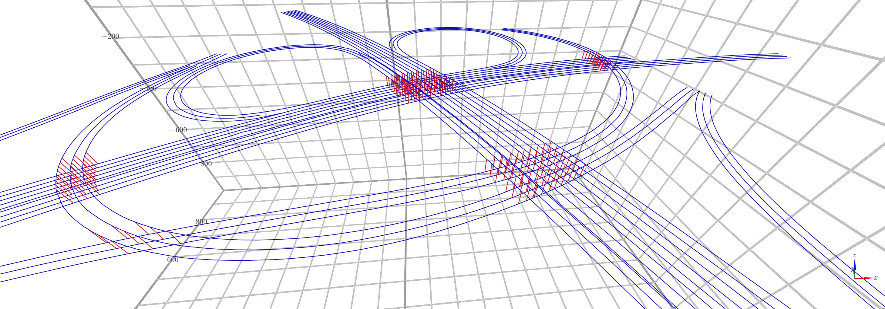

# fast crossing



(See jupyter notebook [here](https://github.com/cubao/index/blob/master/docs/notebooks/fast-crossing.ipynb))

<!--intro-start-->

Fast polyline (line segments) intersection (fast version of bentley-ottmann).

## Installation

### via pip

```bash
pip install -U fast-crossing
```

### from source

```bash
git clone --recursive https://github.com/cubao/fast-crossing
pip install ./fast-crossing
```

Or

```bash
pip install git+https://github.com/cubao/fast-crossing.git
```

(you can build wheels for later reuse by ` pip wheel git+https://github.com/cubao/fast-crossing.git`)

## Related

Inspired by [anvaka/isect: Segments intersection detection library](https://github.com/anvaka/isect).

<!--intro-end-->

## Batch queries

Per-point Python loops are dominated by per-call overhead (pybind return-value
construction, result vectors, Eigen temporaries), not by the index lookup. When
you have N points to query against one index, use the batch entry points:

```python
import numpy as np
from fast_crossing import FastCrossing, ScanlineHitFilterOptions

fc = FastCrossing()
for i, polyline in enumerate(polylines):          # (M, 3) or (M, 2), ENU
    fc.add_polyline(polyline, index=i)
fc.finish()

# 1) batch nearest (point based, like the single-point `nearest`)
counts, poly_idx, pt_idx, dists = fc.nearest_batch(points_xyz, k=3)
#    counts: (N,)   real hit count per query
#    poly_idx/pt_idx: (N, k)  -1 where unused
#    dists: (N, k)   inf where unused

# ...or with a radius instead of k
counts, poly_idx, pt_idx, dists = fc.nearest_batch(points_xyz, radius=2.0, max_hits=8)

# 2) batch lateral candidates: "which polylines cross a scanline through
#    each point, perpendicular to that point's heading"
options = ScanlineHitFilterOptions()
options.accept_opposite = True   # accept near-same AND near-opposite direction
options.min_dot = 0.9            # ... but reject perpendicular hits (|dot| < 0.9)
options.max_height_offset = 0.0  # ignore z

(counts, lateral, poly_idx, seg_idx, t, dot, hit_lla, hit_dir) = (
    fc.intersections_batch(llas, dirs, min=-5.0, max=5.0, options=options, max_hits=1)
)
#    counts:  (N,)     real hit count *before* truncation, so
#                      counts[i] > max_hits means "truncated"
#    lateral: (N, H)   signed lateral offset (left positive), |lateral| ascending
#    poly_idx/seg_idx: (N, H)  -1 where unused
#    t, dot:  (N, H)   NaN where unused
#    hit_lla, hit_dir: (N*H, 3)  reshape to (N, H, 3)
```

Conventions shared by both batch APIs:

- **miss** → indexes `-1`, distances `inf` (`nearest_batch`); also `lateral=inf`,
  `t=dot=NaN`, `lla=NaN` (`intersections_batch`);
- **truncation** (`max_hits`) keeps the `max_hits` smallest `|lateral|` hits;
  `counts` always reports the untruncated count so the caller can detect it;
- the index width is `max_hits` when given (never 0), otherwise the widest hit
  count of the batch, so shapes are predictable;
- passing a `NaN` row in `dirs` means "no direction for this query": a
  north-south scanline is used and the direction gates are skipped.

`scanline_hits(lla, dir, min=..., max=..., options=...)` is the single-point
version of `intersections_batch` (same filters, same ordering), for per-point
control or for cross-checking a batch result.

### What batching does *not* fix

Batching removes per-call overhead; it does **not** remove repeated work. If a
solver re-queries the *same* points for every iteration, most of the time is
spent re-doing identical queries — cache them on the caller side. See
[`benchmarks/benchmark_batch_query.py`](benchmarks/benchmark_batch_query.py)
(394 polylines / 4160 segments / 1562 queries) for measured numbers with an
explicit per-call-overhead row:

```bash
python benchmarks/benchmark_batch_query.py run
```

## Usage & Tests

See [`tests/test_basic.py`](tests/test_basic.py):

```python
import numpy as np
import pytest
from fast_crossing import FastCrossing


def test_fast_crossing():
    fc = FastCrossing()

    # add your polylines
    """
                    2 C
                    |
                    1 D
    0               |                  5
    A---------------o------------------B
                    |
                    |
                    -2 E
    """
    fc.add_polyline(np.array([[0.0, 0.0], [5.0, 0.0]]))  # AB
    fc.add_polyline(np.array([[2.5, 2.0], [2.5, 1.0], [2.5, -2.0]]))  # CDE

    # build index
    fc.finish()

    # num_polylines
    assert 2 == fc.num_polylines()
    rulers = fc.polyline_rulers()
    assert len(rulers) == 2
    ruler0 = fc.polyline_ruler(0)
    ruler1 = fc.polyline_ruler(1)
    assert not ruler0.is_wgs84()
    assert not ruler1.is_wgs84()
    assert ruler0.length() == 5
    assert ruler1.length() == 4
    assert fc.polyline_ruler(10) is None

    # intersections
    ret = fc.intersections([1.5, 0], [3.5, 2])
    assert len(ret) == 2
    assert np.linalg.norm(fc.coordinates(ret[0]) - [1.5, 0, 0]) < 1e-15
    assert np.linalg.norm(fc.coordinates(ret[1]) - [2.5, 1, 0]) < 1e-15
    xyz = fc.coordinates(0, 0, 0.2)
    assert np.linalg.norm(xyz - [1.0, 0, 0]) < 1e-15
    with pytest.raises(IndexError) as excinfo:
        xyz = fc.coordinates(2, 0, 0.5)
    assert "map::at" in str(excinfo)

    # query all line segment intersections
    # [
    #    (array([2.5, 0. ]),
    #     array([0.5       , 0.33333333]),
    #     array([0, 0], dtype=int32),
    #     array([1, 1], dtype=int32))
    # ]
    ret = fc.intersections()
    # print(ret)
    assert len(ret) == 1
    for xy, ts, label1, label2 in ret:
        # xy: intersection point, 2D ('o' in previous illustration)
        # t,s: interpolation ratio (0.5, 0.33)
        #        0.5  ->   o at AB t=1/2
        #        0.33 ->   o at DE s=1/3
        # label1: line segment index, (polyline_index, point_index)
        #        e.g. (0, 0)，first segment of polyline AB (AB is the first polyline)
        # label2: line segment index
        #        e.g. (1, 1)，second segment of polyline CDE
        # print(xy)
        # print(ts)
        # print(label1)
        # print(label2)
        assert np.all(xy == [2.5, 0])
        assert np.all(ts == [0.5, 1 / 3.0])
        assert np.all(label1 == [0, 0])
        assert np.all(label2 == [1, 1])

    # query intersections against provided polyline
    polyline = np.array([[-6.0, -1.0], [-5.0, 1.0], [5.0, -1.0]])
    ret = fc.intersections(polyline)
    ret = np.array(ret)  # convert to numpy
    xy = ret[:, 0]  # take all intersection points (2D)
    ts = ret[:, 1]  # all interpolation ratios
    label1 = ret[:, 2]  # all labels (of current polyline）
    label2 = ret[:, 3]  # all labels in tree
    # print(ret, xy, ts, label1, label2)
    assert np.all(xy[0] == [0, 0])
    assert np.all(xy[1] == [2.5, -0.5])
    assert np.all(ts[0] == [0.5, 0])
    assert np.all(ts[1] == [0.75, 0.5])
    assert np.all(label1 == [[0, 1], [0, 1]])
    assert np.all(label2 == [[0, 0], [1, 1]])

    polyline2 = np.column_stack((polyline, np.zeros(len(polyline))))
    ret2 = np.array(fc.intersections(polyline2[:, :2]))
    assert str(ret) == str(ret2)


def test_fast_crossing_intersection3d():
    fc = FastCrossing()
    """
                    2 C
                    |
                    1 D
    0               |                  5
    A---------------o------------------B
                    |
                    |
                    -2 E
    """
    fc.add_polyline(np.array([[0.0, 0.0, 0.0], [5.0, 0.0, 100]]))  # AB
    fc.add_polyline(np.array([[2.5, 2.0, 0.0], [2.5, 1.0, 100], [2.5, -2.0, 0]]))  # CDE
    fc.finish()
    ret = fc.intersections()
    assert len(ret) == 1
    ret = ret[0]
    xyz1 = fc.coordinates(ret, second=False)
    xyz2 = fc.coordinates(ret)
    assert np.linalg.norm(xyz1 - [2.5, 0, 50]) < 1e-10
    assert np.linalg.norm(xyz2 - [2.5, 0, 2 / 3 * 100.0]) < 1e-10


def test_fast_crossing_auto_rebuild_flatbush():
    fc = FastCrossing()
    fc.add_polyline(np.array([[0.0, 0.0, 0.0], [5.0, 0.0, 100]]))  # AB
    fc.add_polyline(np.array([[2.5, 2.0, 0.0], [2.5, 1.0, 100], [2.5, -2.0, 0]]))  # CDE
    ret = fc.intersections()
    assert len(ret) == 1

    fc.add_polyline([[1.5, 0], [3.5, 2]])
    ret = fc.intersections()
    assert len(ret) == 4  # should dedup to 3?


def test_fast_crossing_filter_by_z():
    fc = FastCrossing()
    fc.add_polyline([[0, 0, 0], [1, 0, 0]])
    fc.add_polyline([[0, 0, 10], [1, 0, 10]])
    fc.add_polyline([[0, 0, 20], [1, 0, 20]])
    ret = fc.intersections([[0.5, -1], [0.5, 1]])
    assert len(ret) == 3

    ret = fc.intersections([[0.5, -1], [0.5, 1]], z_min=-1, z_max=1)
    assert len(ret) == 1
    assert fc.coordinates(ret[0])[2] == 0

    ret = fc.intersections([[0.5, -1, 10], [0.5, 1, 10]], z_min=-1, z_max=1)
    assert len(ret) == 1
    assert fc.coordinates(ret[0])[2] == 10

    ret = fc.intersections([[0.5, -1, 20], [0.5, 1, 20]], z_min=-1, z_max=1)
    assert len(ret) == 1
    assert fc.coordinates(ret[0])[2] == 20

    ret = fc.intersections([[0.5, -1, 15], [0.5, 1, 15]], z_min=-6, z_max=6)
    assert len(ret) == 2
    assert fc.coordinates(ret[0])[2] == 10
    assert fc.coordinates(ret[1])[2] == 20


def test_fast_crossing_dedup():
    # should be stable
    for _ in range(100):
        fc = FastCrossing()
        fc.add_polyline([[0, 0, 0], [1, 0, 0], [2, 0, 0]])
        fc.add_polyline([[0, 1, 0], [1, 1, 0], [2, 1, 0]])

        ret = fc.intersections([[1, -1], [1, 1]])
        assert len(ret) == 2
        assert np.all(ret[0][-1] == [0, 0]), ret
        assert np.all(ret[1][-1] == [1, 0]), ret
        assert ret[0][1][1] == 1.0, ret
        assert ret[1][1][1] == 1.0, ret

        ret = fc.intersections([[1, -1], [1, 1]], dedup=False)
        # for idx, row in enumerate(ret):
        #     print(idx, row)
        assert len(ret) == 4
```
